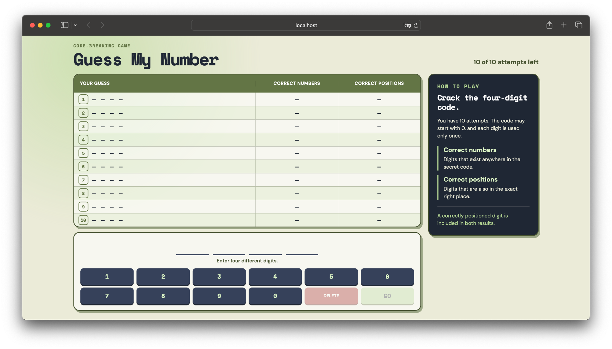

# Guess My Number

Guess My Number is a simple code-breaking game. The player has 10 attempts to find a secret four-digit code using the feedback returned after each guess.

The project consists of a Go REST API and a React frontend.

## Preview



## Current Version

**v1.0.0 - Initial Playable Release**

This is the first playable version of Guess My Number. It includes the Go backend, React frontend, on-screen keypad, physical keyboard support, guess history, attempt tracking, game instructions, and responsive layout.

The project will continue to be improved with new game modes, rule options, persistent storage, and interface enhancements.

## Game Rules

- The secret code contains four different digits.
- The code may start with `0`.
- Each digit can be used only once.
- The player has a maximum of 10 attempts.
- Every guess must contain exactly four different digits.
- Invalid guesses do not reduce the remaining attempt count.

After each guess, the game returns two values:

- **Correct Numbers:** The number of guessed digits that exist anywhere in the secret code.
- **Correct Positions:** The number of guessed digits that are also in the correct position.

Digits in the correct position are included in both results.

### Example

```text
Secret code: 9724
Guess:       9732
```

The result is:

```text
Correct Numbers:   3
Correct Positions: 2
```

The digits `9`, `7`, and `2` exist in the secret code. The digits `9` and `7` are also in the correct positions.

## Technologies

### Backend

- Go 1.22+
- Standard library `net/http`
- In-memory game storage
- Go `testing`
- Race detector

### Frontend

- React
- TypeScript
- Vite
- CSS
- Fetch API

## Project Structure

```text
guess-my-number/
├── backend/
│   ├── game.go
│   ├── game_test.go
│   ├── go.mod
│   ├── main.go
│   └── main_test.go
├── frontend/
│   ├── src/
│   │   ├── App.tsx
│   │   ├── main.tsx
│   │   ├── styles.css
│   │   └── vite-env.d.ts
│   ├── index.html
│   ├── package.json
│   ├── tsconfig.app.json
│   ├── tsconfig.json
│   ├── tsconfig.node.json
│   └── vite.config.ts
└── README.md
```

## Running the Project

### Requirements

Make sure the following tools are installed:

- Go 1.22 or later
- Node.js
- npm

### 1. Clone the repository

```bash
git clone https://github.com/iremsilay/guess-my-number.git
cd guess-my-number
```

### 2. Start the backend

Open a terminal in the repository root:

```bash
cd backend
go test ./...
go run .
```

The backend runs at:

```text
http://localhost:8080
```

Keep this terminal running.

### 3. Start the frontend

Open a second terminal in the repository root:

```bash
cd frontend
npm install
npm run dev
```

Open the following address in the browser:

```text
http://localhost:5173
```

The Vite development server forwards `/games` requests to the backend running at `http://localhost:8080`.

## Controls

The game can be played using the on-screen keypad or a physical keyboard.

| Input | Action |
|---|---|
| `0-9` | Add a digit |
| `Backspace` or `Delete` | Remove the last digit |
| `Enter` | Submit the guess |
| `GO` | Submit the guess |
| `Delete` button | Remove the last digit |

Digits that have already been used in the current guess are disabled.

## API

### Create a Game

```http
POST /games
```

Example request:

```bash
curl -X POST http://localhost:8080/games
```

Example response:

```json
{
  "gameId": "846baa1cf24f1cb5a854ec674ecbfd4b",
  "remainingAttempts": 10,
  "status": "in_progress"
}
```

The secret code is generated and stored by the backend. It is never included in the response.

### Submit a Guess

```http
POST /games/{gameId}/guesses
```

Example request:

```bash
curl -X POST http://localhost:8080/games/846baa1cf24f1cb5a854ec674ecbfd4b/guesses \
  -H "Content-Type: application/json" \
  -d '{"guess":"0123"}'
```

Example response:

```json
{
  "correctNumbers": 2,
  "correctPositions": 0,
  "remainingAttempts": 9,
  "status": "in_progress"
}
```

### Game Status Values

| Status | Meaning |
|---|---|
| `in_progress` | The game is still active |
| `won` | All four digits were guessed in the correct positions |
| `lost` | All 10 attempts were used |

### HTTP Status Codes

| Status code | Meaning |
|---:|---|
| `200 OK` | The guess was processed |
| `201 Created` | A new game was created |
| `400 Bad Request` | The request or guess is invalid |
| `404 Not Found` | The game ID does not exist |
| `409 Conflict` | The game has already ended |
| `500 Internal Server Error` | The server could not create a game |

## Running Backend Tests

Run all backend tests:

```bash
cd backend
go test ./...
```

Run the tests with Go's race detector:

```bash
go test -race ./...
```

Run static analysis:

```bash
go vet ./...
```

The tests cover:

- Secret code generation
- Codes beginning with `0`
- Guess validation
- Correct number calculation
- Correct position calculation
- Winning on the final attempt
- Losing after 10 attempts
- Requests made to a completed game
- Invalid JSON requests
- Unknown game IDs

## Building the Frontend

Create a production build:

```bash
cd frontend
npm run build
```

The generated files are written to the `frontend/dist` directory.

If the frontend and backend are deployed at different addresses, provide the backend address during the build:

```bash
VITE_API_URL=https://api.example.com npm run build
```

The deployed backend must allow requests from the frontend origin when they are hosted on different origins.

## Current Storage Behavior

Games are stored in server memory.

This means:

- Active games are deleted when the backend restarts.
- The application does not currently use a database.
- The current storage approach is intended for local development and a single backend instance.